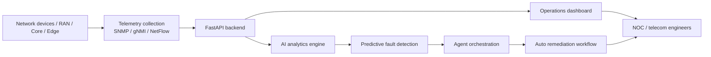
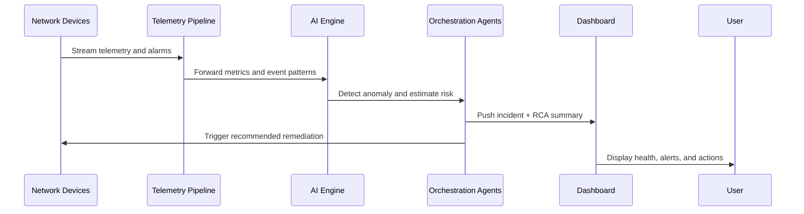

# AutoNetOps

<div align="center">

  
  
  
  

  <h3>Autonomous Telecom Network Optimization</h3>
  <p>
    AI-powered monitoring, predictive maintenance, autonomous remediation, and telecom operations intelligence.
  </p>

</div>

AutoNetOps is a modern telecom operations platform designed to detect network anomalies earlier, reduce downtime, and support autonomous remediation using AI-driven insights.

It combines telecom telemetry, ML-based anomaly detection, orchestration agents, and a dashboard for operators and NOC teams to monitor, diagnose, and resolve issues faster.

---

## Why this project matters

Telecom networks are critical infrastructure. Even a few minutes of service disruption can lead to SLA penalties, user dissatisfaction, increased churn, and expensive emergency maintenance.

This project brings together:

- Real-time telemetry ingestion
- Predictive fault analysis
- Root-cause intelligence
- Agent-based automation
- NOC dashboard visibility

The goal is simple: move from reactive troubleshooting to proactive, intelligent, self-healing network operations.

---

## Solution overview



---

## Operational workflow



---

## Core capabilities

- Predictive fault detection using time-series signals
- Autonomous root-cause analysis for telecom incidents
- Multi-agent workflow coordination for diagnostics and action
- Real-time dashboard for health, alerts, and network trends
- Cloud-ready deployment with Docker, Kubernetes, and Terraform
- Extensible architecture for telecom-specific data sources

---

## Project architecture

```text
Autonomous-Telecomm-Network-Optimization/
├── src/
│   ├── backend/          # FastAPI service and telecom APIs
│   ├── frontend/         # React dashboard for network monitoring
│   ├── ai/               # AI / analytics logic and ML workflows
│   ├── agents/           # Agent orchestration layer
│   └── data/             # Optional telemetry and modeling datasets
├── docker/               # Container definitions
├── kubernetes/            # Kubernetes manifests
├── terraform/             # Infrastructure as code
├── ci-cd/                 # CI/CD configuration
├── requirements.txt      # Python dependencies
├── README.md              # Project documentation
├── .github/               # Repo configuration and Copilot instructions
├── .gitignore
└── LICENSE               # Project license
```

---

## Technology stack

### Frontend
- React.js
- Material UI
- Chart.js
- Real-time operational dashboard

### Backend
- Python
- FastAPI
- Pydantic
- REST APIs for telemetry and incidents

### AI / Operations
- Machine learning workflows
- Anomaly detection and risk modeling
- Autonomous workflow orchestration

### Deployment
- Docker
- Kubernetes
- Terraform
- CI/CD automation

---

## What this repo is doing

This repository is structured as a telecom intelligence platform prototype that demonstrates:

1. Monitoring network health in near real time
2. Detecting abnormal behavior before failure escalates
3. Identifying likely root causes
4. Triggering actionable operations workflows
5. Presenting results in a professional dashboard

It is ideal for portfolio work, research prototypes, and practical telecom AI demonstrations.

---

## Prerequisites

Install the following on your system before running the project:

### Required
- Python 3.10 or newer
- Node.js 18 LTS or newer
- npm 9 or newer
- Git
- A modern browser (Chrome, Edge, or Firefox)

### Recommended
- Docker Desktop / Docker Engine
- VS Code
- Postman or similar API testing tool

### Optional for production-style deployments
- Kubernetes cluster
- Terraform
- Cloud environment credentials

---

## Local setup

Clone the repository:

```bash
git clone https://github.com/mohddilshadkhan2003/Autonomous-Telecomm-Network-Optimization.git
cd Autonomous-Telecomm-Network-Optimization
```

### 1) Backend setup

Create a Python virtual environment:

```bash
python -m venv .venv
source .venv/bin/activate   # Linux / macOS
# .venv\Scripts\activate    # Windows PowerShell
```

Install backend dependencies:

```bash
pip install -r requirements.txt
```

Run the API service:

```bash
cd src/backend
python main.py
```

The backend should be available at:

```text
http://localhost:8000
```

Check the health endpoint:

```bash
curl http://localhost:8000/health
```

### 2) Frontend setup

Open a new terminal and run:

```bash
cd src/frontend
npm install
npm start
```

The dashboard should be available at:

```text
http://localhost:3000
```

---

## Useful API endpoints

```text
GET  /health
GET  /incidents
GET  /dashboard/overview
GET  /network/metrics
POST /ingest/telemetry
POST /agents/trigger
```

Example telemetry payload:

```json
{
  "device_id": "BTS-47-NE",
  "timestamp": "2026-11-02T12:00:00Z",
  "metrics": {
    "packet_loss": 1.8,
    "latency_ms": 34,
    "cpu_usage": 72
  },
  "protocol": "gNMI"
}
```

---

## Run with Docker (optional)

If you want to containerize the application for local testing:

```bash
docker build -t autonetops .
docker run -p 8000:8000 autonetops
```

Note: Docker files are structured for deployment-side experimentation and may need to be adapted for your local environment.

---

## Recommended development workflow

1. Start backend API
2. Start frontend dashboard
3. Send telemetry through the ingest endpoint
4. Monitor incidents and alert trends
5. Trigger agent orchestration for remediation simulation

---

## Project roadmap

### Phase 1
- Telemetry ingestion
- Dashboard and incident view
- Network health analytics

### Phase 2
- ML-driven anomaly detection
- Agent orchestration
- Custom RCA generation

### Phase 3
- Production-grade deployment
- Kubernetes scaling
- Real data integration with telecom systems

---

## Contributing

Contributions are welcome. A common workflow is:

```bash
git checkout -b feature/my-improvement
git commit -m "Add telecom automation enhancement"
git push origin feature/my-improvement
```

Then open a pull request and describe the improvement clearly.

---

## License

This project is currently distributed under the MIT License unless you choose to change it for your own deployment needs.

---

## Final note

This repo is a strong demonstration of an AI-aware telecom operations platform. It blends practical engineering, infrastructure thinking, and intelligent automation in one portfolio-ready solution.

If you want, the next step can be to add a real ML model, database layer, Kafka pipeline, or production Grafana/Prometheus observability stack.

<div align="center">
  <p><strong>Author:</strong> mohddilshadkhan2003</p>
</div>
